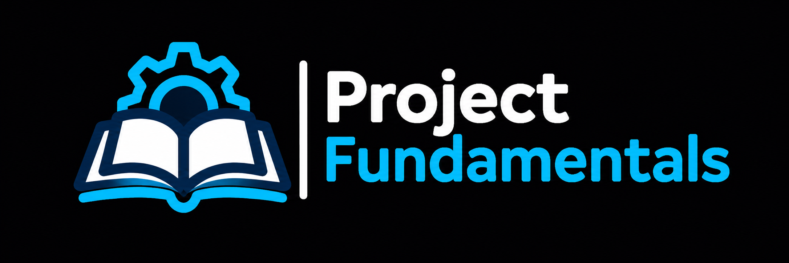

<h3>IDEAS · TECHNOLOGY · OPEN SOURCE · AI</h3>

<strong>Industrial Automation · PLC/SCADA · IT/OT Integration · Software Development</strong>

<a href="https://projectfundamentals.org">Website</a> ·
<a href="mailto:contact@projectfundamentals.org">Contact</a>

---

## About Project Fundamentals

**Project Fundamentals** is an independent initiative focused on sharing knowledge, practical experience and technological solutions.

Our goal is to make industrial technology more accessible through real-world projects, open-source tools, technical documentation and artificial intelligence.

We believe that ideas, experience and technology can work together to turn complex challenges into practical solutions.

## Our Areas of Interest

- **Industrial Automation:** PLC programming, industrial control systems and process optimization.
- **SCADA & Monitoring:** Supervisory systems, data acquisition, alarms and visualization.
- **IT/OT Integration:** Industrial communications, databases, APIs and software connectivity.
- **Software Development:** Practical applications, utilities and custom industrial tools.
- **Open Source & AI:** Collaborative development, accessible knowledge and AI-assisted solutions.

## Our Philosophy

**Explore. Develop. Share. Improve.**

Technology should be accessible, adaptable and continuously evolving.

We believe in the freedom to explore new ideas, develop independent solutions and adapt technology to specific needs.

Our approach combines practical experience, open-source technologies and artificial intelligence to overcome technical challenges and create new possibilities.

We support practical learning, transparent development, knowledge sharing and the responsible use of artificial intelligence.

## Projects

Our repositories will contain technical projects, examples, documentation and tools related to industrial automation and software development.

Our projects may include:

- PLC programming and industrial control applications.
- SCADA systems, monitoring platforms and visualization tools.
- Industrial communication protocols and custom drivers.
- IT/OT integration, databases and data acquisition.
- Python, C# and web-based industrial applications.
- Open-source software, technical resources and AI-assisted development.

Each project will aim to provide practical documentation, implementation examples and reusable resources whenever possible.

New projects will be published progressively.

## Open Source & Artificial Intelligence

We believe that open-source technologies and artificial intelligence can significantly expand what individuals and small teams are capable of creating.

By combining existing tools, practical knowledge and AI-assisted development, we can explore solutions that would otherwise require considerably more resources.

Our objective is not simply to use technology, but to understand it, adapt it and develop solutions tailored to real-world needs.

We encourage experimentation, continuous improvement and responsible innovation.

## Connect With Us

**Website:** https://projectfundamentals.org

**Email:** contact@projectfundamentals.org

**GitHub:** https://github.com/ProjectFundamentals

---

### Imagine a solution.

# Make it real.

### Project Fundamentals

